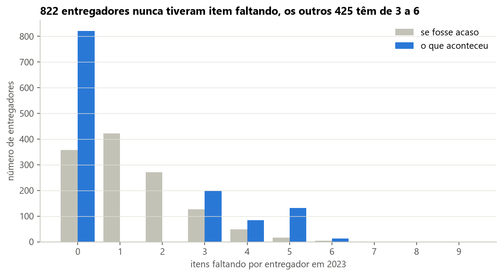
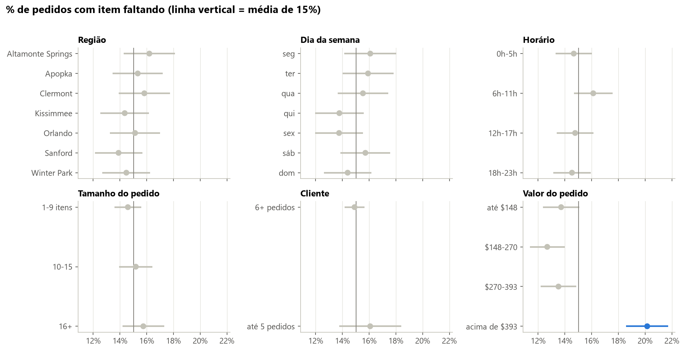
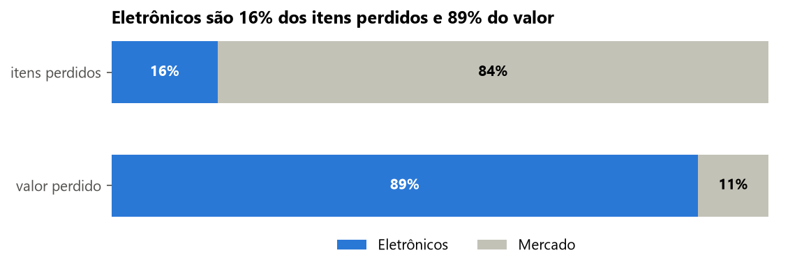
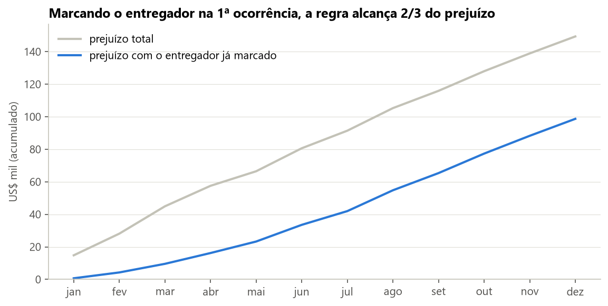
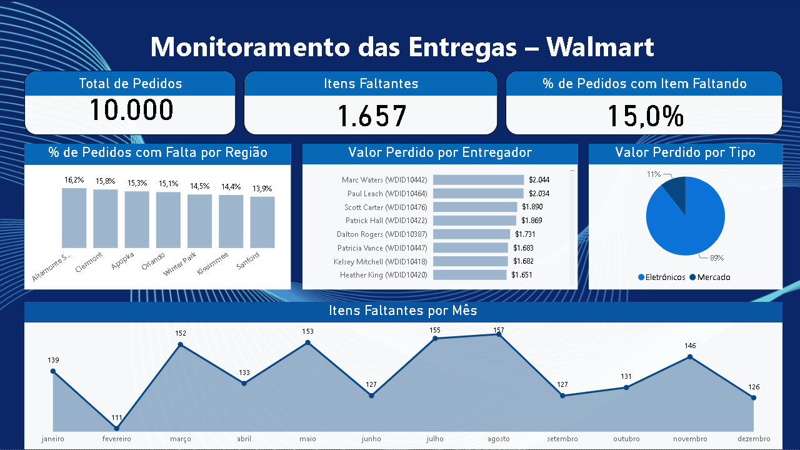

# Fraudes em entregas do Walmart

Projeto final do bootcamp de Data Science da Data Tech Florida (fevereiro de 2025), revisado depois da entrega.

O desafio: o Walmart recebe reclamações de itens que não chegam ao cliente nas entregas da região de Orlando. A partir de 10.000 pedidos de 2023, eu precisava descobrir se a fraude vem dos motoristas, dos clientes ou de alguma falha do processo, e propor medidas para reduzir o prejuízo.

Na versão apresentada no bootcamp fiz as consultas em SQL, um dashboard no Power BI e uma apresentação. Depois, revendo o trabalho, percebi que eu tinha comparado totais em vez de taxas e tirado conclusões de diferenças pequenas. Refiz a análise em Python, testando cada padrão contra o acaso, e algumas conclusões mudaram.

## O que encontrei

**A perda está concentrada em um grupo de entregadores.** De 1.247 entregadores, 822 nunca tiveram item faltando em 2023. Os outros 425 têm item faltando em cerca de um terço das entregas e respondem por 100% da perda. Se a perda fosse aleatória, ela estaria espalhada entre a maioria deles, com 1 ou 2 itens cada.



**Região, dia, horário e tamanho do pedido não fazem diferença.** A taxa de pedidos com item faltando fica perto de 15% em todos esses recortes (entre 13,8% e 16,2%), e as diferenças são do tamanho do acaso. O único fator que muda a taxa é o valor do pedido: acima de US$ 393, 20% dos pedidos têm perda.



**Os clientes não mostram concentração.** Testei da mesma forma e a perda por cliente é a que o acaso produziria.

**Eletrônicos são poucos itens, mas quase todo o prejuízo.** São 16% dos itens perdidos e 89% dos US$ 149 mil perdidos no ano.



**Expectativa de redução.** Simulei uma regra simples: depois da primeira ocorrência, as entregas seguintes do entregador passam a exigir foto e assinatura do cliente. Dois terços do prejuízo do ano aconteceram em pedidos de entregadores que já teriam sido marcados. Se a conferência evitar metade dessas perdas, o prejuízo cai cerca de 33% (uns US$ 49 mil por ano nesta base).



## Dashboard

Painel de monitoramento no Power BI ([dashboard/monitoramento-entregas.pbix](dashboard/monitoramento-entregas.pbix)).



## O que mudou em relação à primeira versão

| Na apresentação | Depois da revisão |
|---|---|
| Altamonte Springs é a região com mais itens faltando | Todas as regiões têm taxa parecida (p = 0,59). Altamonte tinha só alguns itens a mais |
| Os entregadores com mais itens faltando são jovens de 18 anos | O ranking tinha 12 entregadores de 18 anos empatados no topo. Na verdade, os jovens são os que menos aparecem no grupo com perda (18%, contra 44% acima dos 50 anos) |
| Problemas são mais frequentes às sextas e sábados | Não há diferença entre os dias (p = 0,33) |
| Pedidos com mais de 15 itens têm 25% mais problemas | Não há diferença por tamanho (p = 0,45) |
| A coluna de valor do pedido está vazia | Os valores existem. Foi um problema na minha importação para o SQL |
| 1.357 itens de mercado perdidos | 1.393. A consulta com JOIN e OR não contava todas as colunas de produto |
| Dashboard: "Timothy Brown" com 8 itens | São dois entregadores diferentes com o mesmo nome, somados pelo nome. Agora o gráfico mostra nome e ID |
| Dashboard: pizza de "Categoria com mais itens perdidos" | A pizza contava os produtos do cadastro, não os perdidos. Agora mostra o valor perdido por tipo de produto |
| Dashboard: taxa de 0,15 | 15,0% dos pedidos têm item faltando. O número estava certo, mas aparecia como fração |

Alguns pontos da primeira versão continuam valendo: eletrônicos concentram o prejuízo, a comunicação com o cliente na entrega e o teste A/B das medidas.

## Recomendações

1. Marcar o entregador na primeira ocorrência e exigir foto e assinatura do cliente nas entregas seguintes dele.
2. Exigir a mesma conferência em pedidos com eletrônicos ou acima de US$ 400.
3. Validar as duas medidas com teste A/B antes de levar para todas as regiões.
4. Coletar dados que hoje não existem: GPS e tempo parado no endereço, foto da entrega, conferência na saída do estoque e histórico de reclamações.

## Limitações

A base parece sintética. Os padrões são limpos demais (nenhum entregador tem 1 ou 2 itens faltando no ano) e alguns preços não fazem sentido, como iPhone 13 Pro a US$ 180. Com dados reais, a regra de marcar o entregador precisaria de calibragem, porque haveria ocorrências isoladas e legítimas.

## Estrutura

```
dados/          tabelas limpas (pedidos, entregadores, itens perdidos, produtos)
notebooks/      analise.ipynb, a análise completa
sql/            consultas usadas na análise, revisadas
src/            preparar_dados.py, que extrai e limpa as tabelas do arquivo do Power BI
dashboard/      dashboard de monitoramento no Power BI
imagens/        gráficos usados aqui
```

## Como rodar

```
pip install -r requirements.txt
python src/preparar_dados.py
jupyter notebook notebooks/analise.ipynb
```

Os arquivos originais do desafio se perderam depois do bootcamp. Por isso o `preparar_dados.py` lê os dados de dentro do arquivo do Power BI, que guardava uma cópia completa.

## Ferramentas

SQL, Python (pandas, scipy, matplotlib), Power BI.

---

Renata Amaral
